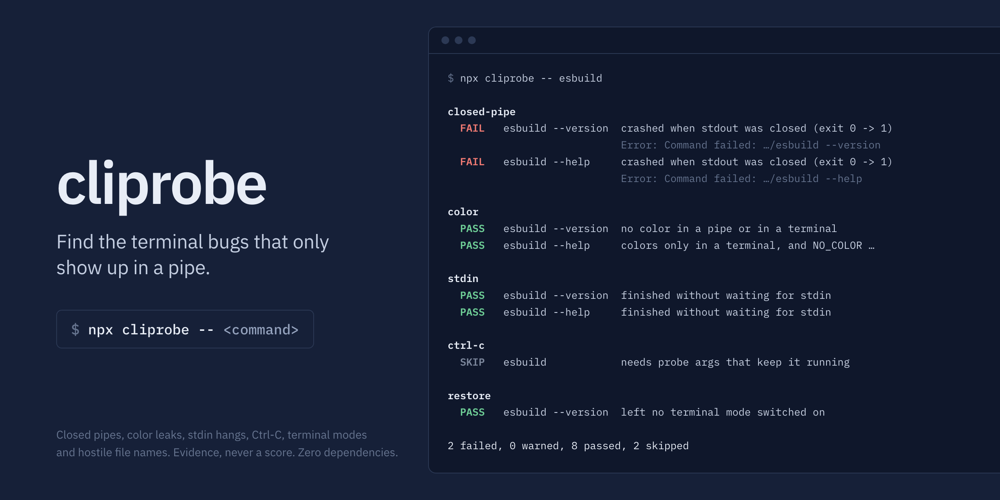

<div align="center">

<a href="https://www.npmjs.com/package/cliprobe">
  
</a>

<h1>cliprobe</h1>

<p><strong>Black-box tests any command-line program for terminal-edge bugs:</strong> the ones that only show up when output is piped, cut short, or read by a script or an AI agent.</p>

<p>
  <a href="https://www.npmjs.com/package/cliprobe"></a>
  <a href="https://www.npmjs.com/package/cliprobe"></a>
  <a href="https://github.com/KhaledSaeed18/cliprobe/actions/workflows/ci.yml"></a>
  <a href="https://www.npmjs.com/package/cliprobe"></a>
  <a href="LICENSE"></a>
</p>

<p>
  <a href="https://github.com/KhaledSaeed18/cliprobe/stargazers"></a>
  <a href="https://github.com/KhaledSaeed18/cliprobe/issues"></a>
  <a href="https://github.com/KhaledSaeed18/cliprobe/releases"></a>
</p>

</div>

---

```sh
npx cliprobe -- esbuild
```

```
cliprobe 0.6.0: closed-pipe, color, pipe-escapes, stdin, ctrl-c, restore, control-chars checks for esbuild

closed-pipe
  FAIL   esbuild --version  crashed when stdout was closed (exit 0 -> 1)
                            Error: Command failed: .../esbuild --version (at node_modules/esbuild/bin/esbuild:222:28)
  FAIL   esbuild --help     crashed when stdout was closed (exit 0 -> 1)
                            Error: Command failed: .../esbuild --help (at node_modules/esbuild/bin/esbuild:222:28)

color
  PASS   esbuild --version  no color in a pipe or in a terminal
  PASS   esbuild --help     colors only in a terminal, and NO_COLOR turns it off

pipe-escapes
  PASS   esbuild --version  no cursor, erase, hyperlink, title or redraw codes in a pipe
  PASS   esbuild --help     no cursor, erase, hyperlink, title or redraw codes in a pipe

stdin
  PASS   esbuild --version  finished without waiting for stdin
  PASS   esbuild --help     finished without waiting for stdin

ctrl-c
  SKIP   esbuild            needs probe args that keep it running, such as a watch or serve command, or --bare

restore
  PASS   esbuild --version  left no terminal mode switched on when it exited
  PASS   esbuild --help     left no terminal mode switched on when it exited

control-chars
  SKIP   esbuild            no {fixture} in the arguments; put it where the command takes a path, e.g. ls {fixture}

2 failed, 0 warned, 8 passed, 2 skipped
```

## Why cliprobe?

When a program's output goes into a reader that stops early (`| head`, `grep -q`, a closed agent pipe), its next write to stdout fails. A well-behaved program exits quietly. Many Node.js CLIs instead crash with `Error: write EPIPE`, a stack trace, and exit code 1. That breaks scripts running under `set -o pipefail` and confuses agents that read stderr.

In a census of the 100 most-downloaded npm packages that ship a command (119 commands, run offline in a throwaway container), **9 crashed this way every time**: esbuild, browserslist, update-browserslist-db, autoprefixer, husky, tsconfck, ts-jest, rolldown, and tsx on `--version`. The best-known existing CLI auditor rated the first 8 as passing its SIGPIPE check. The same census found two commands that print color codes into a pipe (`giget --help`, `tsx --help`), five whose `--help` or `--version` waits for stdin (he, cssesc, ansi-html, webpack and webpack-dev-server), and no false failures: every `FAIL` reproduced by hand. (A census of `--help` and `--version` can't exercise ctrl-c or control-chars, which need a command that keeps running or takes a path; their fixtures and real-tool tests are in `test/`.)

The other checks cover the rest of what goes wrong between a program and the thing reading it: color codes leaking into logs and agent transcripts, Ctrl-C that is ignored or ends in a stack trace, a terminal left with a hidden cursor or no line wrapping after Ctrl-C, and file names that can send escape sequences to your terminal.

- **Evidence, never a score.** Every result is a verdict with the error line, the first stack frame in the target's own code, or the escape sequence that leaked.
- **No false fails.** A new check starts as warn-only and is calibrated against real tools before it may fail.
- **Deterministic.** A closed pipe is a FIFO closed before the program starts, Ctrl-C is a signal to its process group, and the terminal is always 80×24.
- **Any language.** It tests the program from the outside, so a Go, Rust, Python or shell CLI works as well as a Node.js one.
- **Zero dependencies.** Nothing but Node.js and, for the terminal checks, the system's `script` command.

## Contents

- [Installation](#installation)
- [Usage](#usage)
- [Exit codes](#exit-codes)
- [In CI](#in-ci)
- [Checks](#checks): [closed-pipe](#closed-pipe), [color](#color), [pipe-escapes](#pipe-escapes), [stdin](#stdin), [ctrl-c](#ctrl-c), [restore](#restore), [control-chars](#control-chars), [info checks](#info-checks)
- [Fixing a failure in a Node.js CLI](#fixing-a-failure-in-a-nodejs-cli)
- [Safety](#safety)
- [Contributing](#contributing)
- [License](#license)

## Installation

Requires Node.js 22.12 or later, on macOS or Linux (including Alpine). Windows isn't supported yet. Run it without installing:

```sh
npx cliprobe -- <command>
```

Or add it to a project, to run in CI against your own CLI:

```sh
npm install --save-dev cliprobe    # or: pnpm add -D cliprobe
```

## Usage

```sh
npx cliprobe -- <command>                 # probes "<command> --version" and "<command> --help"
npx cliprobe -- <command> [args...]       # probes exactly this invocation
npx cliprobe -- node ./dist/cli.js list   # test your own CLI before publishing
npx cliprobe --json -- <command>          # machine-readable results
npx cliprobe --format junit -o report.xml -- <command>   # JUnit file for CI; human report on stdout
npx cliprobe -- ls {fixture}              # {fixture}: a directory of hostile file names
npx cliprobe --bare -- htop               # the command alone: a REPL, a full-screen program, a server
npx cliprobe --check startup,baseline -- node ./dist/cli.js   # info checks, only when named
```

| Option                       | Meaning                                                                                                                        |
| ---------------------------- | ------------------------------------------------------------------------------------------------------------------------------ |
| `--bare`                     | Probe the command with no arguments instead of `--version` and `--help`, as a probe you wrote                                  |
| `--check <name>`             | Run only this check; repeat it or use commas for several                                                                       |
| `--format <name>`            | Output format: `human` (default), `json`, `markdown` (a GitHub job summary or PR comment) or `junit` (XML for CI test reports) |
| `--json`                     | Same as `--format json`                                                                                                        |
| `-o`, `--output-file <path>` | Write the `--format` report to a file (atomically, creating parent folders); the human report still prints                     |
| `--timeout <ms>`             | Kill a probe after this long (default 15000); a command still running then is judged on what it did so far                     |
| `-h`, `--help`               | Show help                                                                                                                      |
| `-v`, `--version`            | Show the version                                                                                                               |

## Exit codes

| Code | Meaning                                   |
| ---- | ----------------------------------------- |
| `0`  | No check failed                           |
| `1`  | A check failed                            |
| `2`  | Usage error, or the command could not run |

A command that isn't on `PATH` is reported once, before any check runs, with exit `2` and no report. That makes cliprobe usable as a CI gate.

## In CI

A failed check exits 1, so the step fails. In GitHub Actions, write a Markdown report to the job summary while the log keeps the human report:

```yaml
- name: Check the CLI for terminal-edge bugs
  run: npx --yes cliprobe@0 --format markdown --output-file "$GITHUB_STEP_SUMMARY" -- node ./dist/cli.js
```

For CI systems that read test results, write JUnit XML instead and keep it even when the step fails:

```yaml
- run: npx --yes cliprobe@0 --format junit --output-file reports/cliprobe.xml -- node ./dist/cli.js
- uses: actions/upload-artifact@v7
  if: always()
  with:
    name: cliprobe-report
    path: reports/cliprobe.xml
```

In JUnit, each check is a test suite and each probe a test case: `FAIL` is a failure, could-not-run an error, `SKIP` skipped; `WARN`, `INFO` and `PASS` pass, with the verdict and reason in the case's output.

## Checks

A default run does the seven checks below: closed-pipe, color, pipe-escapes, stdin, ctrl-c, restore and control-chars. Each one reports evidence, never a score. Two info checks, startup and baseline, run only when you name them with `--check`.

A command that keeps running, such as a server, a watcher or a full-screen program, is what ctrl-c and restore need. The other checks judge it on what it did before the timeout (`--timeout`, 15 seconds by default): a crash once stdout is closed still fails, color or a spinner in a pipe still counts, and stdin is skipped. The timeout is paid once: after the first check sees the command still running, the others watch it for 3 seconds.

### closed-pipe

cliprobe runs the command twice: once normally, then with stdout set to a pipe whose reading end is already closed, so the first write fails every time, even for fast native programs. Results:

| Verdict | Meaning                                                                                                                    |
| ------- | -------------------------------------------------------------------------------------------------------------------------- |
| `PASS`  | Exited quietly, or was stopped by SIGPIPE (the Unix convention), or kept running without a write error                     |
| `FAIL`  | Printed an EPIPE error or stack trace and changed its exit code, or hung, or crashed on it while a normal run kept running |
| `WARN`  | Printed a write error but kept its exit code                                                                               |
| `SKIP`  | Wrote nothing to stdout for this invocation (or before the timeout), so pass args that print something                     |

Servers and watchers crash the same way. Among 38 watch and serve modes of popular npm tools, 8 died with `Error: write EPIPE` as soon as their stdout reader went away, each confirmed by hand: `jest --watchAll`, `live-server`, `mocha --watch`, `nodemon`, `parcel`, `rolldown -w`, `srvx` and `vite build --watch`. None was flagged falsely.

### color

cliprobe runs the command up to three times: into a pipe, under a real terminal (a pseudo-terminal through the system's `script` command, 80×24), and under a terminal with `NO_COLOR=1`. Every run gets `TERM=xterm-256color` and no `CI` variable, so a program can't pass just because the terminal type looks colorless, and color libraries that force color in CI don't fail it. Color codes in piped output end up in log files and agent transcripts as `\x1b[31m` noise. Results:

| Verdict | Meaning                                                                                                        |
| ------- | -------------------------------------------------------------------------------------------------------------- |
| `PASS`  | No color in a pipe; in a terminal, either no color at all or color that `NO_COLOR` turns off                   |
| `FAIL`  | Printed color or style codes (bold counts, a bare reset doesn't) to stdout in a pipe                           |
| `WARN`  | Printed color to stderr in a pipe, or kept printing color under `NO_COLOR`                                     |
| `SKIP`  | Printed nothing, waited for input in a terminal, or no `script` command (on Alpine, install `util-linux-misc`) |

Many classic tools (git, BSD `ls` and `grep`) color correctly but don't implement [`NO_COLOR`](https://no-color.org), so they get a `WARN`, never a `FAIL`. Probe a command that prints color in normal use: almost no CLI colors its `--help`.

### pipe-escapes

cliprobe runs the command into a pipe, with the same environment as the color check, and looks at stdout and stderr for terminal control codes that only make sense on a screen: cursor movement, line and screen erases, mode switches such as hiding the cursor, hyperlinks (OSC 8), window titles, and carriage returns that redraw a line. Spinners and progress bars are the usual source. In a pipe they turn logs and agent transcripts into `\r\x1b[2K` noise. Results:

| Verdict | Meaning                                                                    |
| ------- | -------------------------------------------------------------------------- |
| `PASS`  | None of those codes reached the pipe (color is the color check's business) |
| `WARN`  | One or more reached stdout or stderr; the reason lists which kinds         |
| `SKIP`  | Printed nothing                                                            |

It only warns for now, never fails. In the census of the top 100 npm CLIs, no `--help` or `--version` printed any of these codes, which says nothing about their spinners: probe a command that does real work, such as an install or a build. With `{fixture}` in the args, the hostile file names themselves are left to the control-chars check: a lister that prints them raw into a pipe, as `ls` does, isn't warned about.

### stdin

Agents and CI runners often start a command with stdin as a pipe that stays open and never receives anything. A program that reads stdin, or asks a question, then waits forever. cliprobe runs the command three ways: with stdin closed (`/dev/null`), with an open pipe, and, if that hangs for 3 seconds, with a pipe it closes after 1 second. Finishing right after the close proves stdin was the cause. Results:

| Verdict | Meaning                                                                                                                   |
| ------- | ------------------------------------------------------------------------------------------------------------------------- |
| `PASS`  | Finished without waiting for stdin                                                                                        |
| `FAIL`  | `--version` or `--help` waited for stdin before answering: they must never need input                                     |
| `WARN`  | A probe you wrote printed an unfinished line, like a question, then waited: it prompts even though stdin isn't a terminal |
| `SKIP`  | A probe you wrote waited silently, like a filter (`grep pattern`), or the hang wasn't caused by stdin                     |

In the census of the top 100 npm CLIs, 9 of 238 `--help` and `--version` runs failed, each confirmed by hand. he, cssesc and ansi-html read stdin before looking at their arguments. webpack and webpack-dev-server, when webpack-cli is missing, ask whether to install it and wait for an answer without checking for a terminal. With no arguments, 17 tools waited on stdin as filters by design, which is why probes you write never fail this check.

### ctrl-c

cliprobe lets the command run for 1 second, then sends SIGINT to its process group, which is what a terminal does when you press Ctrl-C, and gives it 3 seconds to exit. Results:

| Verdict | Meaning                                                                                        |
| ------- | ---------------------------------------------------------------------------------------------- |
| `PASS`  | Stopped by SIGINT, exited 130 (the convention), or exited with another failure code            |
| `FAIL`  | Still running 3 seconds later, or printed a stack trace or traceback after the Ctrl-C          |
| `WARN`  | Exited 0, so a script or an agent can't tell the work was interrupted                          |
| `SKIP`  | Finished before the Ctrl-C, as `--version` and `--help` do: probe a command that keeps running |

A stack trace printed before the Ctrl-C doesn't count. Python's default `KeyboardInterrupt` traceback is the classic failure here, so `python3 -c 'import time; time.sleep(30)'` fails.

### restore

Spinners, prompts and full-screen programs switch terminal modes on: they hide the cursor, open the alternate screen, turn on mouse reporting or bracketed paste, or turn line wrapping off. If they don't switch them back off on the way out, the shell they return to is broken until you run `reset`: no cursor, a blank screen, mouse clicks typed as junk, long lines cut off at the edge. cliprobe runs the command under a terminal and, for probes you write, types Ctrl-C after 1 second, as a person would. The keystroke goes through the terminal, so a program in raw mode gets it as a key rather than a signal, just as it would from a keyboard. `--version` and `--help` aren't interrupted; they're judged as they exit. Results:

| Verdict | Meaning                                                                                                                     |
| ------- | --------------------------------------------------------------------------------------------------------------------------- |
| `PASS`  | Left no mode switched on, either because it never switched one or because it switched each back off (or reset the terminal) |
| `WARN`  | Left one or more on; the evidence quotes each sequence that was never undone and its line                                   |
| `SKIP`  | Still running 3 seconds after Ctrl-C (REPLs quit on a second one), more than 1 MiB of output, or no usable `script` command |

It only warns: a terminal left in the wrong mode is a nuisance you can undo, not a failure of the program's job. Across the top 100 npm CLIs, their watch modes and servers, and popular prompt and spinner libraries (about 300 runs), nothing warned falsely, and one tool really did break the terminal: `taze -I` turns line wrapping off for its progress bars and leaves it off after Ctrl-C.

### control-chars

Put `{fixture}` in the arguments where your command takes a path, for example `npx cliprobe -- ls {fixture}` or `npx cliprobe -- node ./dist/cli.js scan --dir={fixture}`. cliprobe replaces it with a temporary directory of file names holding escape sequences (one sets the window title, one clears the screen), a C1 control character, a carriage return, a newline and a bidirectional override. It runs the command under a terminal and looks for those characters, unescaped, in what reaches it. A file name that can clear someone's screen or retitle their window is a terminal injection, the same bug class as the `ls`/`find` escaping that GNU coreutils added years ago. Reports show `{fixture}`, never the temporary path, and the directory is removed afterwards. Results:

| Verdict | Meaning                                                                                                                                           |
| ------- | ------------------------------------------------------------------------------------------------------------------------------------------------- |
| `PASS`  | Escaped or replaced the control characters (a raw bidi override is mentioned, not judged)                                                         |
| `FAIL`  | Sent an escape sequence from a file name to the terminal unescaped                                                                                |
| `WARN`  | Printed a C1 control, carriage return or newline from a file name unescaped, which can hide or forge output                                       |
| `SKIP`  | No `{fixture}` in the arguments, the command never printed the file names (before the timeout, for one that keeps running), or no usable `script` |

Only the terminal run is judged. Into a pipe, `ls` and `find` print names exactly, by design; that is recorded in the JSON (`pipeRaw`) but doesn't affect the verdict. BSD `find` on macOS fails this check: unlike GNU `find`, it prints names raw even to a terminal.

### Info checks

These report an observation with the verdict `INFO` and never fail. They run only when named, for example `--check startup,baseline`. With probe args, those args are treated as the program: `npx cliprobe --check baseline -- node ./dist/cli.js` probes `node ./dist/cli.js --version`, and so on.

**startup**. The median wall time over 5 runs, after one warm-up, of `<command> --version`, or of the probe exactly as given. It's skipped if that invocation exits non-zero.

**baseline**. Appends `--version`, `--help` and `--cliprobe-unknown-flag` to the probe and describes what scripts and agents rely on: one version line on stdout, help on stdout with exit 0, and a non-zero exit with the message on stderr for a flag the program doesn't know. A program that ignores unknown flags will run its default action (it's stopped after 5 seconds), which is why baseline never runs unless you ask for it.

## Fixing a failure in a Node.js CLI

**closed-pipe:** handle `EPIPE` on stdout once, near your entry point:

```js
process.stdout.on('error', (error) => {
  if (error.code === 'EPIPE') process.exit(0);
  throw error;
});
```

**color:** decide once, from the stream you write to:

```js
const useColor = process.stdout.isTTY && !process.env.NO_COLOR;
```

`util.styleText` makes that decision for you on Node 22.13 and later (its `validateStream` option, on by default), and most color libraries check `isTTY` already, but some turn color on whenever `TERM` allows it or `CI` is set.

**stdin:** look at your arguments before reading stdin, so `--help` and `--version` answer at once, and only prompt when stdin is a terminal:

```js
if (process.stdin.isTTY) askTheQuestion();
else useTheDefault(); // or fail with a message saying which flag to pass
```

**ctrl-c:** Node's default already does the right thing, dying by SIGINT. If you add a handler to clean up, finish by exiting 130 rather than 0, and don't throw from it:

```js
process.once('SIGINT', async () => {
  await cleanUp();
  process.exit(130);
});
```

**restore:** switch every mode back off on the way out, including after Ctrl-C. Node runs `exit` handlers on `process.exit()` but not when a signal kills it, so turn SIGINT into an exit, and in raw mode, where Ctrl-C arrives as the key `\x03`, exit on that key too:

```js
process.stdout.write('\x1b[?25l'); // hide the cursor
process.on('exit', () => process.stdout.write('\x1b[?25h')); // and always show it again
process.once('SIGINT', () => process.exit(130));
```

**control-chars:** escape names (and any other text you didn't write) before printing them for a person. `JSON.stringify` alone isn't enough: it leaves C1 controls and bidi overrides raw.

```js
const shown = name.replace(
  /[\x00-\x1f\x7f-\x9f]/g,
  (c) => `\\x${c.charCodeAt(0).toString(16).padStart(2, '0')}`
);
```

Also escape U+2028, U+2029 and the bidi controls (U+202A to U+202E, U+2066 to U+2069) if names may come from untrusted sources.

## Safety

cliprobe runs the target in your current directory without a shell, with stdin closed (`/dev/null`; the stdin check also uses a pipe that it never writes to), a temporary `HOME`, and a minimal environment (no tokens from your shell). It still executes the program, so only probe programs you trust. By default cliprobe passes only the arguments you give, or `--version` and `--help`, or none with `--bare`; only the baseline check, when you name it, adds an unknown flag. The only input it ever sends is Ctrl-C, from the ctrl-c and restore checks, to probes you write. It kills each run's whole process group on timeout, including under a pseudo-terminal. It runs on macOS and Linux, including Alpine; the terminal checks need the `script` command, which Alpine ships in `util-linux-misc`. Windows isn't supported yet.

## Contributing

Bug reports and pull requests are welcome. Development needs Node.js 22.12 or later and pnpm (the version is pinned in `package.json`):

```sh
pnpm install
pnpm dev --check closed-pipe -- printf hi   # run the CLI from source
pnpm check                                  # everything CI runs
```

[AGENTS.md](AGENTS.md) describes the layout, the product rules and how to add a check. Commits follow [Conventional Commits](https://www.conventionalcommits.org), and every `feat` or `fix` merged to `main` is released to npm.

## License

[MIT](LICENSE), by [Khaled Saeed](https://github.com/KhaledSaeed18).
