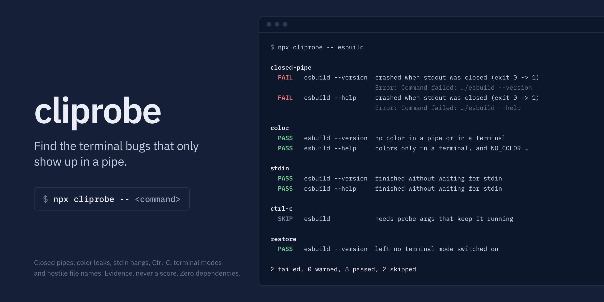

<div align="center">

<a href="https://www.npmjs.com/package/cliprobe">
  
</a>

<h1>cliprobe</h1>

<p><strong>Black-box tests any command-line program for terminal-edge bugs:</strong> the ones that only show up when output is piped, cut short, or read by a script or an AI agent.</p>

<p>
  <a href="https://www.npmjs.com/package/cliprobe"></a>
  <a href="https://www.npmjs.com/package/cliprobe"></a>
  <a href="https://github.com/KhaledSaeed18/cliprobe/actions/workflows/ci.yml"></a>
  <a href="https://www.npmjs.com/package/cliprobe"></a>
  <a href="https://github.com/KhaledSaeed18/cliprobe/blob/main/LICENSE"></a>
</p>

<p>
  <a href="https://github.com/KhaledSaeed18/cliprobe/stargazers"></a>
  <a href="https://github.com/KhaledSaeed18/cliprobe/issues"></a>
  <a href="https://github.com/KhaledSaeed18/cliprobe/releases"></a>
</p>

</div>

---

```sh
npx cliprobe -- tsx
```

```
cliprobe 1.4.3: closed-pipe, color, pipe-escapes, stdin, ctrl-c, sigterm, restore, control-chars checks for tsx

closed-pipe
  FAIL   tsx --version  crashed when stdout was closed (exit 0 -> 1)
                        Error: write EPIPE (at node_modules/tsx/dist/cli.mjs:53:36962)
  PASS   tsx --help     exited quietly

color
  PASS   tsx --version  no color in a pipe or in a terminal
  FAIL   tsx --help     printed color codes into a pipe
                        stdout line 5: \x1b[1mUsage:\x1b[22m

pipe-escapes
  PASS   tsx --version  no cursor, erase, hyperlink, title or redraw codes in a pipe
  PASS   tsx --help     no cursor, erase, hyperlink, title or redraw codes in a pipe

stdin
  PASS   tsx --version  finished without waiting for stdin
  PASS   tsx --help     finished without waiting for stdin

ctrl-c
  SKIP   tsx            needs a probe that keeps running, such as a watch or serve command (--probe), or --bare

sigterm
  SKIP   tsx            needs a probe that keeps running, such as a watch or serve command (--probe), or --bare

restore
  PASS   tsx --version  left no terminal mode switched on when it exited
  PASS   tsx --help     left no terminal mode switched on when it exited

control-chars
  SKIP   tsx            no {fixture} in the arguments; add a probe that takes a path, e.g. --probe "ls {fixture}"

2 failed, 0 warned, 8 passed, 3 skipped
```

<sub>tsx 4.23.15, run offline in a container in November 2026.</sub>

## Why cliprobe?

When a program's output goes into a reader that stops early (`| head`, `grep -q`, a closed agent pipe), its next write to stdout fails. A well-behaved program exits quietly. Many Node.js CLIs instead crash with `Error: write EPIPE`, a stack trace, and exit code 1. That breaks scripts running under `set -o pipefail` and confuses agents that read stderr.

In a census of the 100 most-downloaded npm packages that ship a command (119 commands, run offline in a throwaway container), **9 crashed this way every time**: esbuild, browserslist, update-browserslist-db, autoprefixer, husky, tsconfck, ts-jest, rolldown, and tsx on `--version`. Since then esbuild and browserslist have fixed it; the other seven still crashed when re-checked at their November 2026 versions. The best-known existing CLI auditor rated the first 8 as passing its SIGPIPE check. The same census found two commands that print color codes into a pipe (`giget --help`, `tsx --help`), five whose `--help` or `--version` waits for stdin (he, cssesc, ansi-html, webpack and webpack-dev-server), and no false failures: every `FAIL` reproduced by hand. (A census of `--help` and `--version` can't exercise ctrl-c, sigterm or control-chars, which need a command that keeps running or takes a path; their fixtures and real-tool tests are in `test/`.)

The other checks cover the rest of what goes wrong between a program and the thing reading it: color codes leaking into logs and agent transcripts, Ctrl-C that is ignored or ends in a stack trace, child processes left running after `kill` or `docker stop`, a terminal left with a hidden cursor or no line wrapping after Ctrl-C, and file names that can send escape sequences to your terminal.

- **Evidence, never a score.** Every result is a verdict with the error line, the first stack frame in the target's own code, or the escape sequence that leaked.
- **No false fails.** A new check starts as warn-only and is calibrated against real tools before it may fail.
- **Deterministic.** A closed pipe is a FIFO closed before the program starts, Ctrl-C is a signal to its process group, and the terminal is always 80×24.
- **Any language.** It tests the program from the outside, so a Go, Rust, Python or shell CLI works as well as a Node.js one.
- **Zero dependencies.** Nothing but Node.js and, for the terminal checks, the system's `script` command.

## Contents

- [Installation](#installation)
- [Usage](#usage)
- [Exit codes](#exit-codes)
- [In CI](#in-ci)
- [JSON output](#json-output)
- [Stability](#stability)
- [Checks](#checks): [closed-pipe](#closed-pipe), [color](#color), [pipe-escapes](#pipe-escapes), [stdin](#stdin), [ctrl-c](#ctrl-c), [sigterm](#sigterm), [restore](#restore), [control-chars](#control-chars), [info checks](#info-checks)
- [Fixing a failure in a Node.js CLI](#fixing-a-failure-in-a-nodejs-cli)
- [Agent skill](#agent-skill)
- [Safety](#safety)
- [FAQ](#faq)
- [Contributing](#contributing)
- [License](#license)

## Installation

Requires Node.js 22.12 or later, on macOS or Linux (including Alpine). Windows isn't supported yet. The terminal checks (color, restore and control-chars) also need the system's `script` command, which macOS has and most Linux distributions install by default. Without it they're skipped, and each skip says so. If it's missing, install the package that has it: `bsdutils` on Debian and Ubuntu, `util-linux-script` on Fedora, `util-linux-misc` on Alpine.

Run it without installing:

```sh
npx cliprobe -- <command>
```

Or add it to a project, to run in CI against your own CLI:

```sh
npm install --save-dev cliprobe    # or: pnpm add -D cliprobe
```

## Usage

```sh
npx cliprobe -- <command>                 # probes "<command> --version" and "<command> --help"
npx cliprobe -- <command> [args...]       # probes exactly this invocation
npx cliprobe --probe "watch app.ts" -- tsx   # adds a probe: --version, --help and "watch app.ts"
npx cliprobe -- node ./dist/cli.js list   # test your own CLI before publishing
npx cliprobe --json -- <command>          # machine-readable results
npx cliprobe --format junit -o report.xml -- <command>   # JUnit file for CI; human report on stdout
npx cliprobe -- ls {fixture}              # {fixture}: a directory of hostile file names
npx cliprobe --bare -- htop               # the command alone: a REPL, a full-screen program, a server
npx cliprobe --check startup,baseline -- node ./dist/cli.js   # info checks, only when named
npx cliprobe --strict --skip restore -- node ./dist/cli.js server   # warnings fail too, except restore's
```

| Option                       | Meaning                                                                                                                                                                                                                                                                                      |
| ---------------------------- | -------------------------------------------------------------------------------------------------------------------------------------------------------------------------------------------------------------------------------------------------------------------------------------------- |
| `--bare`                     | Probe the command with no arguments instead of `--version` and `--help`, as a probe you wrote                                                                                                                                                                                                |
| `--probe <args>`             | Also probe `<command> <args>`; repeat it for several. Split like a shell command line (quotes and backslashes, no variables or wildcards). The args after `<command>` aren't kept: with `-- node ./cli.js`, write `--probe "./cli.js watch"`                                                 |
| `--check <name>`             | Run only this check; repeat it or use commas for several                                                                                                                                                                                                                                     |
| `--skip <name>`              | Leave this check out; repeat it or use commas for several                                                                                                                                                                                                                                    |
| `--strict`                   | Exit 1 on a warning too, not only on a failure                                                                                                                                                                                                                                               |
| `--format <name>`            | Output format: `human` (default), `json`, `markdown` (a GitHub job summary or PR comment) or `junit` (XML for CI test reports)                                                                                                                                                               |
| `--json`                     | Same as `--format json`                                                                                                                                                                                                                                                                      |
| `-o`, `--output-file <path>` | Write the `--format` report to a file (replaced atomically, keeping its mode and following symlinks, with parent folders created; a FIFO, `/dev/stdout` or `/dev/fd/N` is written in place); the human report still prints. For a path that starts with `-`, write `-o=<path>` or `./<path>` |
| `--timeout <ms>`             | Kill a probe after this long (default 15000, at most 2147483647, about 24 days); a command still running then is judged on what it did so far                                                                                                                                                |
| `-h`, `--help`               | Show help                                                                                                                                                                                                                                                                                    |
| `-v`, `--version`            | Show the version                                                                                                                                                                                                                                                                             |

An option's value follows it or comes after `=` (`--format=json`). A value that is another option, as in `-o --strict`, is a usage error rather than a file named `--strict`. `--probe` is the exception: its value may start with `-`, to probe a flag (`--probe --json`).

A probe runs `<command>` with its own args, in place of the args after the command, not after them. So when the command is an interpreter, name the script in every probe: `npx cliprobe --probe "./dist/cli.js watch" -- node ./dist/cli.js` probes `node ./dist/cli.js` and `node ./dist/cli.js watch`, while `--probe watch` would run `node watch`. A probe that exits with a failure code and is skipped says so in its reason, with the error line from stderr as evidence, so a probe that never ran as intended doesn't pass for a quiet skip.

## Exit codes

| Code | Meaning                                                                                    |
| ---- | ------------------------------------------------------------------------------------------ |
| `0`  | No check failed                                                                            |
| `1`  | A check failed, or warned with `--strict`                                                  |
| `2`  | Usage error, the command could not run, or the `--output-file` report could not be written |

A command that can't run is reported once, before any check runs, with exit `2` and no report: one that isn't on `PATH`, a directory, a file without the execute bit (`chmod +x`), or a script whose `#!` interpreter is missing. A file this system can't execute at all, such as a binary built for another platform, makes every check say could-not-run (`ERROR`), so cliprobe exits `2` there too; on Linux, where `/bin/sh` tries such a file as a script, cliprobe recognizes the shell's complaint. An `--output-file` path that can't be written, such as a directory or a folder without write permission, is also reported before any check runs, with exit `2`. If the file still can't be written at the end, cliprobe prints the human report first, so no result is lost, then the error, and exits `2` even when a check failed: CI fails the step either way. That makes cliprobe usable as a CI gate.

## In CI

A failed check exits 1, so the step fails. Warnings don't fail it unless you add `--strict`; with `--strict`, `--skip` leaves out a check whose warning you accept. Add `--probe` for a command that keeps running and one with `{fixture}`, so a single step covers every check. In GitHub Actions, write a Markdown report to the job summary while the log keeps the human report:

```yaml
- name: Check the CLI for terminal-edge bugs
  run: npx --yes cliprobe@1 --format markdown --output-file "$GITHUB_STEP_SUMMARY" -- node ./dist/cli.js
```

For CI systems that read test results, write JUnit XML instead and keep it even when the step fails:

```yaml
- run: npx --yes cliprobe@1 --format junit --output-file reports/cliprobe.xml -- node ./dist/cli.js
- uses: actions/upload-artifact@v7
  if: always()
  with:
    name: cliprobe-report
    path: reports/cliprobe.xml
```

In JUnit, each check is a test suite and each probe a test case: `FAIL` is a failure, could-not-run an error, `SKIP` skipped; `WARN`, `INFO` and `PASS` pass, with the verdict and reason in the case's output.

## JSON output

`--format json` (or `--json`) writes one report, described by a JSON Schema that ships in the package as `cliprobe/schema.json`:

```json
{
  "tool": "cliprobe",
  "schemaVersion": 1,
  "version": "1.0.0",
  "command": "node",
  "checks": ["ctrl-c"],
  "strict": false,
  "summary": { "pass": 0, "fail": 1, "warn": 0, "skip": 0, "error": 0, "info": 0 },
  "results": [
    {
      "check": "ctrl-c",
      "invocation": ["node", "server.js"],
      "verdict": "fail",
      "reason": "ignored Ctrl-C: still running 3 s later",
      "details": {
        "sentAfterMs": 1003,
        "exitedAfterMs": null,
        "exitCode": null,
        "signal": "SIGKILL",
        "stderrAfter": ""
      }
    }
  ]
}
```

`strict` says whether `--strict` was given (added in 1.1). Every result has the same five fields: `check`, `invocation` (the command and arguments that ran), `verdict` (`pass`, `fail`, `warn`, `skip`, `error` for could-not-run, or `info`), `reason` (a sentence for a person) and `details`, plus `evidence` when there is a line to quote. `details` holds the check's own measurements, such as exit codes, timings, the terminal modes left on or the processes left running; the schema describes each check's. Text from the program under test is escaped: control characters, line separators and bidi overrides appear as `\u` escapes, so the report can't drive a terminal when printed. The human report shows them as `\x1b`-style escapes and doubles a backslash the program printed, so `\\x1b` is text and `\x1b` a real escape character; it cuts evidence longer than 200 characters, which the JSON has in full.

## Stability

From 1.0, cliprobe follows semantic versioning, and these hold for every 1.x release:

- **No new failures.** A minor release never makes a passing or warning program fail. New checks, and new things an existing check notices, only warn until the next major release. So `cliprobe@1` in CI turns red only when your program changes.
- **Names and exit codes.** Check names, verdicts, options and exit codes stay as they are.
- **`--strict` opts out of the first promise.** It fails on warnings, so a new warning in a minor release can fail your build. Pin an exact version (`cliprobe@1.1.0`) if that matters, or `--skip` the check.
- **JSON.** `schemaVersion` stays `1`. Fields are only added, never removed, renamed or given a new type.
- **Not covered.** The wording of `reason` and `evidence`, and the human and Markdown output, are for people and may change. Match on `check` and `verdict`, not on text.

## Checks

A default run does the eight checks below: closed-pipe, color, pipe-escapes, stdin, ctrl-c, sigterm, restore and control-chars. Each one reports evidence, never a score. Two info checks, startup and baseline, run only when you name them with `--check`.

A command that keeps running, such as a server, a watcher or a full-screen program, is what ctrl-c, sigterm and restore need. Give it after the command, or add it with `--probe` to keep the `--version` and `--help` probes in the same run; ctrl-c and sigterm only run the probes you name, and control-chars only those with `{fixture}`, so one run covers every check:

```sh
npx cliprobe --probe "serve --port 0" --probe "scan {fixture}" -- my-cli
```

The other checks judge it on what it did before the timeout (`--timeout`, 15 seconds by default): a crash once stdout is closed still fails, color or a spinner in a pipe still counts, and stdin is skipped. The timeout is paid once: after the first check sees the command still running, the others watch it for 3 seconds.

### closed-pipe

cliprobe runs the command twice: once normally, then with stdout set to a pipe whose reading end is already closed, so the first write fails every time, even for fast native programs. Results:

| Verdict | Meaning                                                                                                                    |
| ------- | -------------------------------------------------------------------------------------------------------------------------- |
| `PASS`  | Exited quietly, or was stopped by SIGPIPE (the Unix convention), or kept running without a write error                     |
| `FAIL`  | Printed an EPIPE error or stack trace and changed its exit code, or hung, or crashed on it while a normal run kept running |
| `WARN`  | Printed a write error but kept its exit code                                                                               |
| `SKIP`  | Wrote nothing to stdout for this invocation (or before the timeout), so pass args that print something                     |

Servers and watchers crash the same way. Among 38 watch and serve modes of popular npm tools, 8 died with `Error: write EPIPE` as soon as their stdout reader went away, each confirmed by hand: `jest --watchAll`, `live-server`, `mocha --watch`, `nodemon`, `parcel`, `rolldown -w`, `srvx` and `vite build --watch`. None was flagged falsely.

### color

cliprobe runs the command up to three times: into a pipe, under a real terminal (a pseudo-terminal through the system's `script` command, 80×24), and under a terminal with `NO_COLOR=1`. Every run gets `TERM=xterm-256color` and no `CI` variable, so a program can't pass just because the terminal type looks colorless, and color libraries that force color in CI don't fail it. Color codes in piped output end up in log files and agent transcripts as `\x1b[31m` noise. Results:

| Verdict | Meaning                                                                                                     |
| ------- | ----------------------------------------------------------------------------------------------------------- |
| `PASS`  | No color in a pipe; in a terminal, either no color at all or color that `NO_COLOR` turns off                |
| `FAIL`  | Printed color or style codes (bold counts, a bare reset doesn't) to stdout in a pipe                        |
| `WARN`  | Printed color to stderr in a pipe, or kept printing color under `NO_COLOR`                                  |
| `SKIP`  | Printed nothing, waited for input in a terminal, or no `script` command (see [Installation](#installation)) |

Many classic tools (git, BSD `ls` and `grep`) color correctly but don't implement [`NO_COLOR`](https://no-color.org), so they get a `WARN`, never a `FAIL`. Probe a command that prints color in normal use: almost no CLI colors its `--help`.

### pipe-escapes

cliprobe runs the command into a pipe, with the same environment as the color check, and looks at stdout and stderr for terminal control codes that only make sense on a screen: cursor movement, line and screen erases, mode switches such as hiding the cursor, hyperlinks (OSC 8), window titles, and carriage returns that redraw a line. Spinners and progress bars are the usual source. In a pipe they turn logs and agent transcripts into `\r\x1b[2K` noise. Results:

| Verdict | Meaning                                                                                                                                        |
| ------- | ---------------------------------------------------------------------------------------------------------------------------------------------- |
| `PASS`  | None of those codes reached the pipe (color is the color check's business)                                                                     |
| `FAIL`  | An escape sequence reached stdout or stderr; the reason lists which kinds                                                                      |
| `WARN`  | Only carriage returns reached the pipe, redrawing a line as a progress meter does, or only control codes this check started looking for in 1.5 |
| `SKIP`  | Printed nothing                                                                                                                                |

A carriage-return redraw only warns because some tools draw a progress meter on stderr into a pipe by design: curl does, unless you pass `-s`. Before this check could fail, it ran on 78 commands doing real work (builds, linters, test runners, scaffolders, package managers and system tools) and 38 watch modes and dev servers, offline in a throwaway container. Every escape sequence it found was a real bug, such as a prompt hiding the cursor in a pipe (`changeset init`), `mocha --watch` hiding the cursor and `tsc --watch` clearing the screen; none was a false failure. Probe a command that does real work, such as an install or a build: `--help` and `--version` rarely draw spinners. With `{fixture}` in the args, the hostile file names themselves are left to the control-chars check: a lister that prints them raw into a pipe, as `ls` does, passes. If the codes come from data you passed in (a file you `cat`), they are yours, not the program's.

Since 1.5 the check also finds the other escape sequences: saving and restoring the cursor (`ESC 7`, `ESC 8`), a full reset that clears the screen (`ESC c`), character set and keypad switches, device control strings (DCS, APC, PM, SOS), OSC codes without a `;` (`ESC ] 104`), and their 8-bit forms (C1 CSI and OSC, such as `0x9b 2J`). These only warn until a census of real tools shows they flag no working program; `details.stdoutKinds` and `details.stderrKinds` name them as `escape`, `reset`, `string`, `osc` and `c1`. A program that also prints one of the sequences above still fails.

### stdin

Agents and CI runners often start a command with stdin as a pipe that stays open and never receives anything. A program that reads stdin, or asks a question, then waits forever. cliprobe runs the command three ways: with stdin closed (`/dev/null`), with an open pipe, and, if that hangs, with a pipe it closes partway through. Finishing only after the close proves stdin was the cause. The open pipe gets 3 seconds, or twice the time the command took with stdin closed plus 1 second if that is longer, so a program that is just slow to answer isn't mistaken for one that waits. The pipe in the third run is closed after 1 second, or after that longer time for a slow command. Each run still stops at `--timeout`. Results:

| Verdict | Meaning                                                                                                                                                |
| ------- | ------------------------------------------------------------------------------------------------------------------------------------------------------ |
| `PASS`  | Finished without waiting for stdin                                                                                                                     |
| `FAIL`  | `--version` or `--help` waited for stdin before answering: they must never need input                                                                  |
| `WARN`  | A probe you wrote printed an unfinished line, like a question, then waited: it prompts even though stdin isn't a terminal                              |
| `SKIP`  | A probe you wrote waited silently, like a filter (`grep pattern`), the hang wasn't caused by stdin, or the command is too slow for `--timeout` to tell |

In the census of the top 100 npm CLIs, 9 of 238 `--help` and `--version` runs failed, each confirmed by hand. he, cssesc and ansi-html read stdin before looking at their arguments. webpack and webpack-dev-server, when webpack-cli is missing, ask whether to install it and wait for an answer without checking for a terminal. With no arguments, 17 tools waited on stdin as filters by design, which is why probes you write never fail this check.

### ctrl-c

cliprobe lets the command run for 1 second, then sends SIGINT to its process group, which is what a terminal does when you press Ctrl-C, and gives it 3 seconds to exit. stdin is left open, as a terminal leaves it, so a server that stops at the end of stdin (`esbuild --serve`) keeps running until the Ctrl-C. Results:

| Verdict | Meaning                                                                                                                                                                                                  |
| ------- | -------------------------------------------------------------------------------------------------------------------------------------------------------------------------------------------------------- |
| `PASS`  | Stopped by SIGINT, exited 130 (the convention), or exited with another failure code                                                                                                                      |
| `FAIL`  | Still running 3 seconds later, or printed a stack trace or traceback after the Ctrl-C                                                                                                                    |
| `WARN`  | Exited 0, so a script or an agent can't tell the work was interrupted, or exited but left processes running that ignored the Ctrl-C (the evidence names the first)                                       |
| `SKIP`  | Finished before the Ctrl-C, as `--version` and `--help` do: probe a command that keeps running. With `--bare`, also a command still running after the Ctrl-C that never printed anything, as a REPL does |

A stack trace printed before the Ctrl-C doesn't count. Python's default `KeyboardInterrupt` traceback is the classic failure here, so `python3 -c 'import time; time.sleep(30)'` fails. Across 42 watch modes, dev servers and long tasks run offline (vite, webpack, tsc, jest, Next.js, Nuxt, Astro, wrangler, nodemon and more), every one stopped within 60 ms of the Ctrl-C, whether it came after 1, 3 or 6 seconds, so the timing rarely matters. 13 of them exit 0 on purpose, among them `tsc --watch`, webpack, `next dev` and `nuxt dev`: that is a warn, not a fail.

A REPL run with `--bare` (`npx cliprobe --bare -- python3`) gets a pipe as stdin here, not a terminal, so it waits to read a script and may not stop on Ctrl-C, which nobody at a terminal sees. So with `--bare`, a command that is still running 3 seconds after the Ctrl-C and never printed anything is skipped, as restore skips REPLs, rather than failed. One that printed something first, such as a server's banner, still fails. To check a REPL's Ctrl-C, try it in a terminal.

The verdict is about the program itself: it passes once it exits, even if a child still holds its output open. What it leaves running gets 1 more second to follow, then is listed and killed. A process still there ignored the Ctrl-C, as a shell's background job does (`sh -c 'worker & server'`), so it would outlive the terminal's Ctrl-C too: that is a warn, added in 1.4.

### sigterm

`kill <pid>`, `docker stop`, systemd, pm2 and CI runners that cancel a job send SIGTERM to the program alone, not to its process group as a terminal sends Ctrl-C. So a program that started children (a dev server, a worker pool, a shell running a command) has to stop them itself. If it exits without doing so, they keep running with nobody to stop them, holding their ports and files. cliprobe lets the command run for 1 second, sends SIGTERM to it alone, and gives it 3 seconds to exit and 1 more second for its children to follow, then lists what is still running and kills it: in its process group, and the processes it started in a group or session of their own (Node's `detached`, `setsid`, daemons). stdin is left open, as for ctrl-c. Results:

| Verdict | Meaning                                                                                                                                     |
| ------- | ------------------------------------------------------------------------------------------------------------------------------------------- |
| `PASS`  | Exited, by the signal or with any exit code, and left nothing running                                                                       |
| `WARN`  | Exited but left processes running (the evidence names the first), still running 3 seconds later, or printed a stack trace after the SIGTERM |
| `SKIP`  | Finished before the SIGTERM, as `--version` and `--help` do: probe a command that keeps running                                             |

It only warns for now. Across 44 watch modes, dev servers and long tasks run offline, every one exited within 90 ms of the SIGTERM, and 37 left nothing behind: vite, webpack, tsc, jest, Next.js, Nuxt, Astro, wrangler, nodemon, concurrently and more stop their own children. All 7 warnings were real, with the process still running 5 seconds later: `npm run dev`, `npm run serve` and `npx vite`, because npm dies on SIGTERM without passing it on (run `node` directly in a container or a process manager), and shell wrappers such as `sh -c 'node server.js'` or `bash -c 'sleep 30; echo done'`. Nothing ignored SIGTERM or printed a stack trace.

### restore

Spinners, prompts and full-screen programs switch terminal modes on: they hide the cursor, open the alternate screen, turn on mouse reporting or bracketed paste, or turn line wrapping off. If they don't switch them back off on the way out, the shell they return to is broken until you run `reset`: no cursor, a blank screen, mouse clicks typed as junk, long lines cut off at the edge. cliprobe runs the command under a terminal and, for probes you write, types Ctrl-C after 1 second, as a person would. The keystroke goes through the terminal, so a program in raw mode gets it as a key rather than a signal, just as it would from a keyboard. `--version` and `--help` aren't interrupted; they're judged as they exit. Results:

| Verdict | Meaning                                                                                                                     |
| ------- | --------------------------------------------------------------------------------------------------------------------------- |
| `PASS`  | Left no mode switched on, either because it never switched one or because it switched each back off (or reset the terminal) |
| `WARN`  | Left one or more on; the evidence quotes each sequence that was never undone and its line                                   |
| `SKIP`  | Still running 3 seconds after Ctrl-C (REPLs quit on a second one), more than 1 MiB of output, or no usable `script` command |

It only warns: a terminal left in the wrong mode is a nuisance you can undo, not a failure of the program's job. Across the top 100 npm CLIs, their watch modes and servers, and popular prompt and spinner libraries (about 300 runs), nothing warned falsely, and one tool really did break the terminal: `taze -I` turns line wrapping off for its progress bars and leaves it off after Ctrl-C.

### control-chars

Put `{fixture}` in the arguments where your command takes a path, for example `npx cliprobe -- ls {fixture}`, `npx cliprobe -- node ./dist/cli.js scan --dir={fixture}` or `npx cliprobe --probe "scan {fixture}" -- my-cli`. cliprobe replaces it with a temporary directory of file names holding escape sequences (one sets the window title, one clears the screen), a C1 control character, a carriage return, a newline and a bidirectional override. It runs the command under a terminal and looks for those characters, unescaped, in what reaches it. A file name that can clear someone's screen or retitle their window is a terminal injection, the same bug class as the `ls`/`find` escaping that GNU coreutils added years ago. Reports show `{fixture}`, never the temporary path, and the directory is removed afterwards. Results:

| Verdict | Meaning                                                                                                                                           |
| ------- | ------------------------------------------------------------------------------------------------------------------------------------------------- |
| `PASS`  | Escaped or replaced the control characters (a raw bidi override is mentioned, not judged)                                                         |
| `FAIL`  | Sent an escape sequence from a file name to the terminal unescaped                                                                                |
| `WARN`  | Printed a C1 control, carriage return or newline from a file name unescaped, which can hide or forge output                                       |
| `SKIP`  | No `{fixture}` in the arguments, the command never printed the file names (before the timeout, for one that keeps running), or no usable `script` |

Only the terminal run is judged. Into a pipe, `ls` and `find` print names exactly, by design; that is recorded in the JSON (`details.pipeRaw`) but doesn't affect the verdict. BSD `find` on macOS fails this check: unlike GNU `find`, it prints names raw even to a terminal.

### Info checks

These report an observation with the verdict `INFO` and never fail. They run only when named, for example `--check startup,baseline`. With args after the command, those args are treated as the program (`--probe` adds probes, not a different program): `npx cliprobe --check baseline -- node ./dist/cli.js` probes `node ./dist/cli.js --version`, and so on.

**startup**. The median wall time over 5 runs, after one warm-up, of `<command> --version`, or of the probe exactly as given. It's skipped if that invocation exits non-zero.

**baseline**. Appends `--version`, `--help` and `--cliprobe-unknown-flag` to the probe and describes what scripts and agents rely on: one version line on stdout, help on stdout with exit 0, and a non-zero exit with the message on stderr for a flag the program doesn't know. A program that ignores unknown flags will run its default action (it's stopped after 5 seconds), which is why baseline never runs unless you ask for it.

## Fixing a failure in a Node.js CLI

**closed-pipe:** handle `EPIPE` on stdout once, near your entry point:

```js
process.stdout.on('error', (error) => {
  if (error.code === 'EPIPE') process.exit(0);
  throw error;
});
```

**color:** decide once, from the stream you write to:

```js
const useColor = process.stdout.isTTY && !process.env.NO_COLOR;
```

`util.styleText` makes that decision for you on Node 22.13 and later (its `validateStream` option, on by default), and most color libraries check `isTTY` already, but some turn color on whenever `TERM` allows it or `CI` is set.

**pipe-escapes:** draw spinners, progress bars and prompts only when the stream is a terminal, and print plain lines otherwise:

```js
if (process.stderr.isTTY) {
  startSpinner(); // frames, \r and cursor codes only on a terminal
} else {
  console.error('building...'); // one plain line per step in a pipe
}
```

Most spinner libraries check `isTTY` already. Prompt libraries may not, so check `process.stdin.isTTY` before asking anything (see stdin below).

**stdin:** look at your arguments before reading stdin, so `--help` and `--version` answer at once, and only prompt when stdin is a terminal:

```js
if (process.stdin.isTTY) askTheQuestion();
else useTheDefault(); // or fail with a message saying which flag to pass
```

**ctrl-c:** Node's default already does the right thing, dying by SIGINT. If you add a handler to clean up, finish by dying the same way, and don't throw from it:

```js
process.once('SIGINT', async () => {
  await cleanUp();
  process.kill(process.pid, 'SIGINT'); // the handler is gone, so this ends the process
});
```

That matters to the shell that started you: bash stops a script on Ctrl-C only when the program died by the signal. After an exit with 130 or 0, the script carries on to its next command; 130 at least stops `&&` chains and `set -e`, which 0 doesn't.

**sigterm:** stop what you started before you exit. Pass the signal on to each child and wait for it:

```js
const server = spawn(process.execPath, ['server.js'], { stdio: 'inherit' });
process.once('SIGTERM', () => {
  server.once('exit', () => process.exit(0));
  server.kill('SIGTERM');
});
```

A shell wrapper should `exec` its last command (`sh -c 'exec node server.js'`), so the signal goes straight to it instead of to a shell that dies and leaves it running.

**restore:** switch every mode back off on the way out, including after Ctrl-C. Node runs `exit` handlers on `process.exit()` but not when a signal kills it, so turn SIGINT into an exit, and in raw mode, where Ctrl-C arrives as the key `\x03`, exit on that key too:

```js
process.stdout.write('\x1b[?25l'); // hide the cursor
process.on('exit', () => process.stdout.write('\x1b[?25h')); // and always show it again
process.once('SIGINT', () => process.exit(130));
```

**control-chars:** escape names (and any other text you didn't write) before printing them for a person. `JSON.stringify` alone isn't enough: it leaves C1 controls and bidi overrides raw.

```js
const shown = name.replace(
  /[\x00-\x1f\x7f-\x9f]/g,
  (c) => `\\x${c.charCodeAt(0).toString(16).padStart(2, '0')}`
);
```

Also escape U+2028, U+2029 and the bidi controls (U+202A to U+202E, U+2066 to U+2069) if names may come from untrusted sources.

## Agent skill

An official [Agent Skill](https://agentskills.io) lets coding agents such as Claude Code, Codex, Gemini CLI and OpenCode use cliprobe on the CLIs they build or review: run every check with the right probes, report each failure with its evidence, propose the fix, and add a CI step. The agents run cliprobe and read its JSON report instead of guessing.

```sh
npx skills add KhaledSaeed18/cliprobe --skill cliprobe
```

Then ask in your own words, for example "check my CLI for pipe and Ctrl-C bugs before I publish it". See [skills/README.md](https://github.com/KhaledSaeed18/cliprobe/blob/main/skills/README.md) for other ways to install it and the evals.

## Safety

cliprobe runs the target in your current directory without a shell, with stdin closed (`/dev/null`; the stdin, ctrl-c and sigterm checks use a pipe that they never write to), a temporary `HOME`, and a minimal environment (no tokens from your shell; see [the probe's environment](#the-probes-environment)). It still executes the program, so only probe programs you trust. By default cliprobe passes only the arguments you give, after the command or with `--probe`, or `--version` and `--help`, or none with `--bare`; only the baseline check, when you name it, adds an unknown flag. The only input it ever sends is Ctrl-C, from the ctrl-c and restore checks, and SIGTERM, from the sigterm check, to probes you write. It kills each run's whole process group on timeout, including under a pseudo-terminal, and when a program exits it kills whatever it left running, in its group or started in another one, in every check. If cliprobe itself is stopped by Ctrl-C, SIGTERM or SIGHUP, it first kills the probe it is running and removes its temporary directories and any half-written report file, then exits by the same signal (130, 143 or 129). It runs on macOS and Linux, including Alpine; the terminal checks need the `script` command (see [Installation](#installation)). Windows isn't supported yet.

### The probe's environment

A probe gets only these variables. Nothing else from your shell reaches it, not even `LC_ALL` or the other `LC_*` variables, so only `LANG` sets the locale:

| Variable             | Value                                                                                                     |
| -------------------- | --------------------------------------------------------------------------------------------------------- |
| `PATH`               | Yours                                                                                                     |
| `LANG`               | Yours, or `C.UTF-8` if you have none                                                                      |
| `HOME`, `TMPDIR`     | A new temporary directory for each run, removed afterwards                                                |
| `TERM`               | `dumb`; `xterm-256color` in color, pipe-escapes and control-chars, and in every run under a terminal      |
| `CI`                 | `1`; unset in color, pipe-escapes and control-chars, so color libraries that force color in CI don't fail |
| `NO_UPDATE_NOTIFIER` | `1`, so update checks stay quiet                                                                          |
| `NO_COLOR`           | `1` in the color check's last run only                                                                    |
| `SHELL`              | `/bin/sh` in runs under a terminal, which `script` needs                                                  |
| `SCRIPT`             | `/dev/null` in runs under a terminal on macOS, set by `script` itself                                     |

The runs under a terminal are color's second and third, restore's, and control-chars'.

## FAQ

**Why were ctrl-c, sigterm and control-chars skipped?** They need probes that a plain `--version` and `--help` run doesn't have: ctrl-c and sigterm need a command that keeps running, such as a server or a watcher, and control-chars needs one that prints file names from `{fixture}`. Add them with `--probe`, so one run covers every check: `npx cliprobe --probe "serve --port 0" --probe "list {fixture}" -- my-cli`. If the reason adds that the probe exited with a failure code, it never ran as intended: check its arguments, and with `-- node ./cli.js`, name the script in the probe (`--probe "./cli.js serve"`).

**My program works when I run it, so why does a check fail?** cliprobe sets up conditions that are rare by hand: stdout closed before the program starts, output into a pipe, stdin that nobody writes to, a minimal environment. Reproduce the failure the way the check's section shows, for example `my-cli --help | head -n 1` for closed-pipe or `my-cli --help | cat -v` for color, and read the evidence in `--json`. If you still believe the verdict is wrong, [open a wrong verdict issue](https://github.com/KhaledSaeed18/cliprobe/issues/new?template=wrong_verdict.yml).

**Why does my program behave differently under cliprobe?** It runs without your shell's variables or your home directory, with `TERM=dumb` and `CI=1` in most checks: [the probe's environment](#the-probes-environment) lists every variable. A program that needs a token or a config file from your home directory sees neither, as on a fresh CI runner.

**Does a pass mean my CLI has no terminal bugs?** No. Each check tests one behavior, on the probes that ran; a subcommand that wasn't probed wasn't checked. cliprobe reports evidence, not a score, so add a `--probe` for each command your users pipe or interrupt.

**Does it only work for Node.js programs?** No. It tests any command as a black box, whatever it is written in. Only the [fixes](#fixing-a-failure-in-a-nodejs-cli) are specific to Node.js.

**Is it safe to probe any program?** cliprobe runs the program with your privileges, so probing it is like running it. Probe untrusted programs inside a disposable container with networking off, for example `docker run --rm --network none`.

**Does it run on Windows?** Not yet. It runs on macOS and Linux, including Alpine. It may work under WSL, but that isn't tested.

## Contributing

Bug reports and pull requests are welcome. The most useful report is a verdict you believe is wrong: open a [wrong verdict issue](https://github.com/KhaledSaeed18/cliprobe/issues/new?template=wrong_verdict.yml) with the program, its version and the `--format json` report. For a bug in cliprobe itself, an idea for a new check or a gap in these docs, [choose an issue form](https://github.com/KhaledSaeed18/cliprobe/issues/new/choose).

Development needs macOS or Linux, Node.js 22.18 or later and pnpm (the version is pinned in `package.json`):

```sh
pnpm install
pnpm dev --check closed-pipe -- printf hi   # run the CLI from source
pnpm check                                  # everything CI runs
```

[CONTRIBUTING.md](https://github.com/KhaledSaeed18/cliprobe/blob/main/CONTRIBUTING.md) covers the setup, the product rules, adding a check, commit messages and how releases work; [AGENTS.md](https://github.com/KhaledSaeed18/cliprobe/blob/main/AGENTS.md) maps the code. Every `feat` or `fix` merged to `main` is released to npm.

Everyone taking part follows the [Code of Conduct](https://github.com/KhaledSaeed18/cliprobe/blob/main/CODE_OF_CONDUCT.md). Report security vulnerabilities privately, as [SECURITY.md](https://github.com/KhaledSaeed18/cliprobe/blob/main/SECURITY.md) describes, and accessibility barriers as [ACCESSIBILITY.md](https://github.com/KhaledSaeed18/cliprobe/blob/main/ACCESSIBILITY.md) describes.

## License

[MIT](https://github.com/KhaledSaeed18/cliprobe/blob/main/LICENSE), by [Khaled Saeed](https://github.com/KhaledSaeed18).
